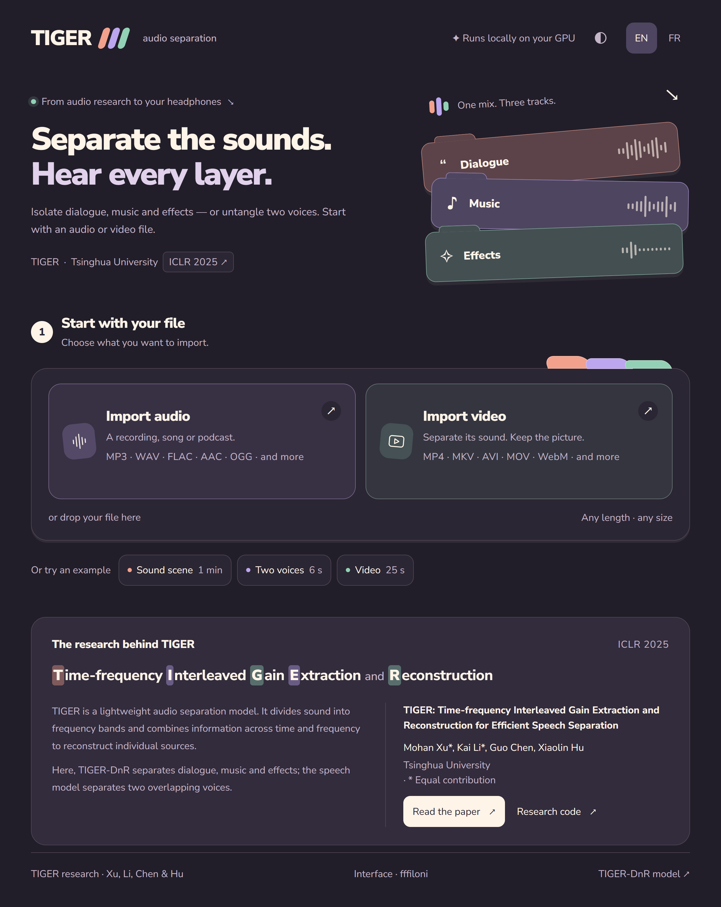

<p align="center">
  
</p>

<h1 align="center">TIGER Audio Extractor — Local</h1>

<p align="center">
  <strong>Separate dialogue, music and sound effects, or untangle two overlapping voices,<br>
  from any audio or video file. Runs entirely on your own NVIDIA GPU.</strong>
</p>

<p align="center">
  
  
  
  
  
</p>



---

## ✨ What it does

TIGER (*Time-frequency Interleaved Gain Extraction and Reconstruction*) is a
lightweight separation model from Tsinghua University (ICLR 2025). This project
wraps it in a polished web interface with a one-click installer, so you can use
it locally with no Python knowledge and no cloud GPU.

| Mode | Input | Output |
|---|---|---|
| 🎬 **Dialogue, music & effects** | A film clip, podcast, game capture… | 3 tracks: **dialogue**, **music**, **effects** |
| 🗣️ **Two overlapping voices** | A recording where two people talk at once | 2 tracks, **one per speaker** |

**Interface features**

- 📂 **Audio or video input of any length and size.** Hour-long films and podcasts are processed in chunks (see [Long files](https://github.com/Mixomo/TIGER-audio-extraction-local#%EF%B8%8F-long-files)).
- 🎛️ **Almost any format.** Anything ffmpeg can read works:
  - **Audio:** MP3, WAV, FLAC, AAC/M4A, OGG/Opus, WMA, AIFF, ALAC, APE, AC3/DTS, and more.
  - **Video:** MP4, MKV, AVI, MOV, WebM, WMV, FLV, MPEG/TS, 3GP, VOB, and more.
- 🎞️ **Video output.** Get each separated track as audio, plus a copy of the video carrying only that sound. The picture is copied without re-encoding whenever possible.
- 🎚️ **Interactive mixer.** Play all tracks in sync. Mute or solo each one, and see aligned waveforms with a shared amplitude scale.
- 🔁 **A/B against the original.** Switch to the untouched mix at any time.
- ⬇️ **One-click downloads** of every track (WAV) and every video.
- 🧪 **Built-in examples** (sound scene, two voices, video) so you can try it right away.
- 🌗 **Light and dark themes**, 🇬🇧/🇫🇷 **English and French** UI.
- 🔌 **API and MCP server.** The Gradio API and the MCP endpoint are enabled, so you can script it or call it from AI agents.

## 💻 System requirements

| | Minimum | Tested |
|---|---|---|
| **OS** | Windows 10/11 64-bit | Windows 11 Pro |
| **GPU** | NVIDIA GPU with CUDA support, 6 GB+ VRAM recommended | RTX 3090 (24 GB) |
| **Disk** | ~9 GB free | — |

You don't need to install anything beforehand: no Python, Git, ffmpeg or CUDA
toolkit. `curl` and `tar` are built into Windows 10/11.

> Without an NVIDIA GPU the app falls back to the CPU. It still works, but it is
> much slower.

## 🚀 Installation

1. **Download** this repository (*Code → Download ZIP*) and extract it to a
   folder **without spaces or special characters** in the path, e.g. `D:\AI\TIGER`.
2. **Double-click `1- install.bat`.** It downloads and sets up, inside the
   project folder only:
   - [uv](https://github.com/astral-sh/uv) (portable)
   - Python 3.10 (portable, managed by uv)
   - ffmpeg / ffprobe (portable)
   - PyTorch 2.8 + CUDA 12.8 and all dependencies into `.venv`
   - The TIGER model weights and example files

   The install takes a few minutes, depending on your connection.

## ▶️ Usage

**Double-click `2- start.bat`.** The app opens in your browser at
**http://127.0.0.1:7860**. Close the console window to stop it.

1. Choose **Import audio** or **Import video** (or click an example).
2. Choose the separation: **Dialogue, music & effects** or **Two overlapping voices**.
3. Click **Create the tracks**, then listen, compare and download.

Speed on an RTX 3090:

| Task | Input | Time |
|---|---|---|
| Dialogue, music & effects | 12 minutes of audio | ~4 min (1.3 GB VRAM) |
| Two overlapping voices | 3 minutes of audio | ~9 s |

**Options.** Set these in a console before running `2- start.bat`:

```bat
rem Share on your local network, on another port
set GRADIO_SERVER_NAME=0.0.0.0
set GRADIO_SERVER_PORT=7861
rem Don't open the browser automatically
set TIGER_NO_BROWSER=1
"2- start.bat"
```

## ⏱️ Long files

There is no length or size limit. Files are processed and written to disk
block by block, so RAM and VRAM use stay flat however long the input is:

- **Dialogue, music & effects:** the audio is processed in 2-minute blocks with
  6-second cross-faded overlaps. The model also uses its own 12-second windows
  inside each block.
- **Two overlapping voices:** the voice model needs about 0.1 GB of VRAM per
  second of audio. Block length therefore adapts to your free VRAM (10–60 s),
  with 4-second cross-faded overlaps. Speaker order stays consistent from one
  block to the next, so *Voice A* stays the same person.
- **Player:** results longer than 10 minutes are streamed to the browser in
  10-second slices instead of being loaded whole. All tracks stay perfectly
  in sync.
- **Videos:** a video the browser can't play (e.g. AVI/MPEG-4, WMV) is
  converted once to H.264 for the preview and the output videos.

The output WAV files are 16-bit; a file larger than 4 GB is saved as RF64.

## 📦 Self-contained by design

Nothing is written outside the project folder and no global cache is used:

```
.uv/        portable uv + Python 3.10
.venv/      Python environment (PyTorch CUDA, Gradio…)
.ffmpeg/    portable ffmpeg / ffprobe
.hf/        Hugging Face settings
cache/      TIGER model weights
examples/   demo media
```

- **Update:** replace the code files and run `1- install.bat` again.
- **Uninstall:** delete the folder.

## 🗂️ Project layout

```
1- install.bat       one-click installer
2- start.bat         launcher
_env.bat             shared environment (keeps everything local)
download_models.py   fetches weights + examples at install time
pyproject.toml       dependencies (uv.lock pins exact versions)
gradio_app.py        app entry point
tiger_ui/            web interface (Gradio + custom HTML/JS/CSS)
tiger_ui/engine.py   model loading + chunked separation of any length
tiger_legacy.py      public API / MCP callbacks
look2hear/           TIGER model code (inference only)
```

## 🛠️ Troubleshooting

| Problem | Fix |
|---|---|
| `CUDA False` at the end of the install | Update your NVIDIA driver to 570 or newer and run `1- install.bat` again. |
| Port 7860 already in use | Set `GRADIO_SERVER_PORT` to another port (see **Options**). |
| Install stopped halfway | Run `1- install.bat` again. Completed steps are skipped. |
| Out of GPU memory | Close other GPU apps. Block size adapts to the free VRAM when a separation starts. |
| Very long video takes a while before separating | Videos the browser can't play are converted to H.264 first. MP4/WebM in H.264, VP9 or AV1 skip this step. |

## 🙏 Credits

- **TIGER model and research:** Mohan Xu, Kai Li, Guo Chen and Xiaolin Hu, Tsinghua University.
  [Paper (ICLR 2025)](https://arxiv.org/abs/2410.01469) · [Project page](https://cslikai.cn/TIGER/) ·
  [Original code](https://github.com/JusperLee/TIGER) ·
  Models: [TIGER-DnR](https://huggingface.co/JusperLee/TIGER-DnR), [TIGER-speech](https://huggingface.co/JusperLee/TIGER-speech)
- **Original web interface:** [fffiloni](https://huggingface.co/fffiloni) (Hugging Face Space).
- **Font:** Nunito Sans (SIL Open Font License, see `tiger_ui/fonts/OFL.txt`).

```bibtex
@inproceedings{xu2025tiger,
  title     = {TIGER: Time-frequency Interleaved Gain Extraction and Reconstruction for Efficient Speech Separation},
  author    = {Xu, Mohan and Li, Kai and Chen, Guo and Hu, Xiaolin},
  booktitle = {International Conference on Learning Representations (ICLR)},
  year      = {2025}
}
```

## 📄 License

- **Code:** the TIGER model code (`look2hear/`) is released by its authors under the
  [MIT License](https://github.com/JusperLee/TIGER/blob/main/LICENSE)
  (Copyright (c) 2026 Kai Li). This local packaging is released under the same MIT License.
- **Model weights:** [TIGER-DnR](https://huggingface.co/JusperLee/TIGER-DnR) and
  [TIGER-speech](https://huggingface.co/JusperLee/TIGER-speech) are licensed under
  **Apache 2.0** by their authors.
